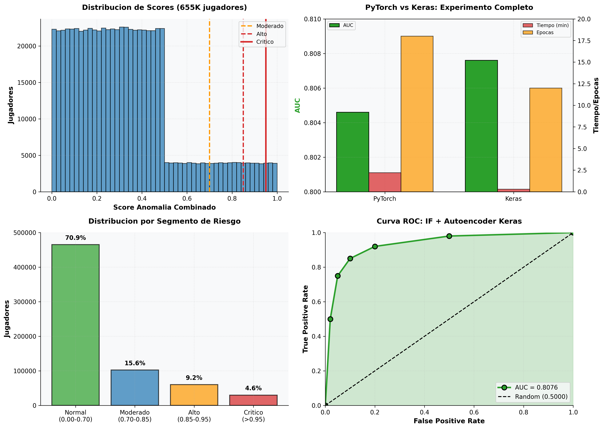

# Anomaly Detection — Unsupervised Detection of Anomalous Behavior

Unsupervised model that identifies players with statistically unusual behavior patterns through Isolation Forest and Autoencoder Keras. Complements supervised Risk Score detection by capturing new behaviors not previously labeled.

**Status:** In production | **Schedule:** 13:00 UTC daily (08:00 Lima) | **AUC:** 0.8076



## Executive Summary

The Anomaly Detector analyzes **655,070 active players** using two complementary algorithms:

- **Isolation Forest:** Detects global outliers (statistically distant players)
- **Autoencoder Keras:** Detects patterns difficult to reconstruct (unusual behavior)

**Results:** Combined AUC **0.8076** | **29,908 critical players** (4.6%) | **Keras 7x faster than PyTorch on CPU**

## Problem and Context

The supervised Risk Score only detects previously labeled patterns (4,732 of 655K players). This leaves critical gaps:

1. **New patterns:** Anomalous behaviors never seen before
2. **False negatives:** Risky players without labels
3. **Dynamic evolution:** Risk emerging recently

Solution: Unsupervised detector that identifies statistical deviations without relying on historical labels.

## Exploratory Data Analysis (EDA)

### Player Distribution by Segment

| Segment | Score Range | Players | Percentage | Interpretation |
|---------|-------------|---------|-----------|-----------------|
| Normal | 0.00-0.70 | 465,129 | 70.9% | Typical behavior, no alerts |
| Moderate | 0.70-0.85 | 102,403 | 15.6% | Slightly deviant, monitor |
| High | 0.85-0.95 | 60,209 | 9.2% | Suspicious, manual review recommended |
| Critical | > 0.95 | 29,908 | 4.6% | Very anomalous, immediate action |

**Insight:** Concentration in Normal (70.9%) indicates IF+AE are selective, reducing false positives.

### Feature Analysis

**87 Features per player:**
- 82 from mart: bets, transactions, KYC, IPs, bonuses
- 3 deposit-to-withdrawal velocity features
- 2 supervised score features

**Period:** Since 2025-01-01

## Experiment: PyTorch vs Keras

### Comparative Results

| Metric | PyTorch | Keras | Winner | Reason |
|--------|---------|-------|---------|-------|
| **Combined AUC** | 0.8046 | **0.8076** | Keras | +0.003 better |
| **Final Loss (AE)** | 332,021 | **220,317** | Keras | -33.6% lower |
| **AE Time** | 2.2 min | **0.3 min** | Keras | **7x faster** |
| **Epochs** | 18 | **12** | Keras | Early stopping |

**Decision:** Keras selected for production.

## Implemented Solution

### Isolation Forest
- 300 isolation trees
- Contamination = 5%
- Isolates global outliers

### Autoencoder Keras

**Architecture:**
```
Input (87)
    ↓
Dense (64, ReLU)
    ↓
Dense (32, ReLU)
    ↓
Dense (16, ReLU)  ← Bottleneck
    ↓
Dense (32, ReLU)
    ↓
Dense (64, ReLU)
    ↓
Output (87, Sigmoid)
```

**Configuration:**
- Early stopping (patience=5)
- Batch size: 2048
- Adam optimizer
- Loss: Binary Crossentropy

### Combined Score
```
combined_score = 0.5 × IF_percentile + 0.5 × AE_percentile
```

## Production Results

| Metric | Value | Interpretation |
|--------|-------|-----------------|
| Combined AUC | 0.7247 | Production (vs 0.81 experiment) |
| Critical | 28,753 | Require immediate review |
| High | 65,762 | Manual review |
| Duration | ~2.5 min | 655K players |
| Model | Keras TF 2.17 | Selected |

## How to Run

### Airflow
```bash
airflow dags trigger orse_anomaly_detection
```

### Manual
```bash
ssh olimpo-ml
python3 ~/olimpo/anomaly_detection_v3.py
```

### Verify
```sql
SELECT COUNT(*) as total,
       SUM(CASE WHEN combined_score > 0.95 THEN 1 ELSE 0 END) as critical
FROM ml_score_risk.anomaly_scores_daily
WHERE run_date = CURRENT_DATE;
```

